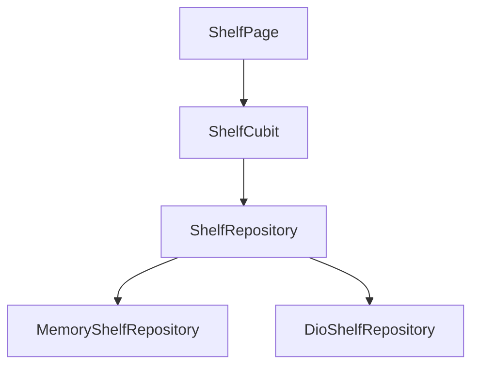

# Shelf

A small reading shelf. The list, the detail page, and the add form share one repository and one Cubit.

The shape follows a feature-first clean architecture: domain types stay free of Flutter and Dio, the repository turns exceptions into `Either<Failure, T>`, and the screen only reads Cubit state. Dependency injection is GetIt, navigation is GoRouter, and the shelf is available in English and Arabic. The running app uses an in-memory shelf. A Dio repository implements the same interface and is covered by a unit test.

This project does not copy the Beetleware template, its packages, fonts, or environment files.

## Layout



## Run

```bash
flutter pub get
flutter run
```

## Test

```bash
dart format --output=none --set-exit-if-changed .
flutter analyze
flutter test
```

## License

[MIT](LICENSE)
